# PinShot · macOS 截图挂件

[](LICENSE)
[](https://www.apple.com/macos/)

> 一键框选截图，直接钉在屏幕上：可以标注、调整大小、浮于最上层或挂在桌面，鼠标移开自动淡出。
> 常驻菜单栏、无 Dock 图标、原生 AppKit，不依赖任何第三方库。
>
官网：https://xincxiong.github.io/PinShot/ · 最新版本：[Releases](https://github.com/xincxiong/PinShot/releases)

**Windows 版（Beta）**：Electron 便携版，见 [`windows/`](windows/)；下载 [PinShot 1.0.0 for Windows](https://github.com/xincxiong/PinShot/releases/tag/v1.0.0-windows)。

> **English**: PinShot is a native macOS screenshot pinboard — region capture, annotation, resizable pinned windows, floating/desktop placement, auto-hide and clipboard pinning. No dependencies, no Dock icon.

```
⇧⌘2  →  拖动框选  →  松手，截图变成置顶挂件  →  鼠标移开自动淡出，扫过即恢复
```

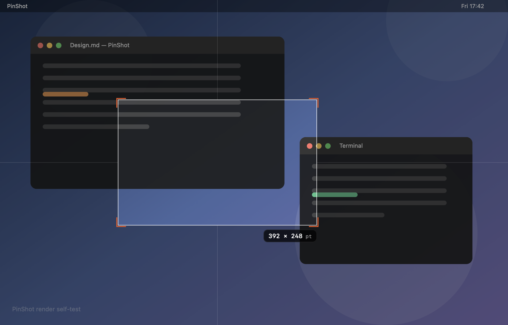

| 四角缩放 + 尺寸徽标 | 挂在桌面（工具栏可切换） |
| --- | --- |
| 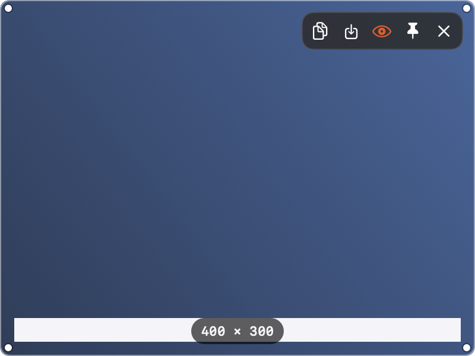 | 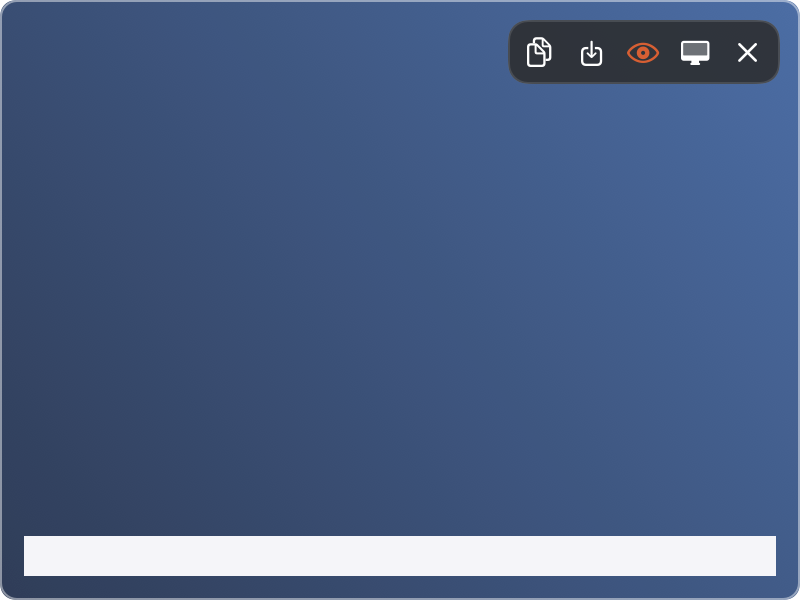 |

| 贴图挂件（悬停工具栏） | 设置窗口（侧边栏） |
| --- | --- |
| 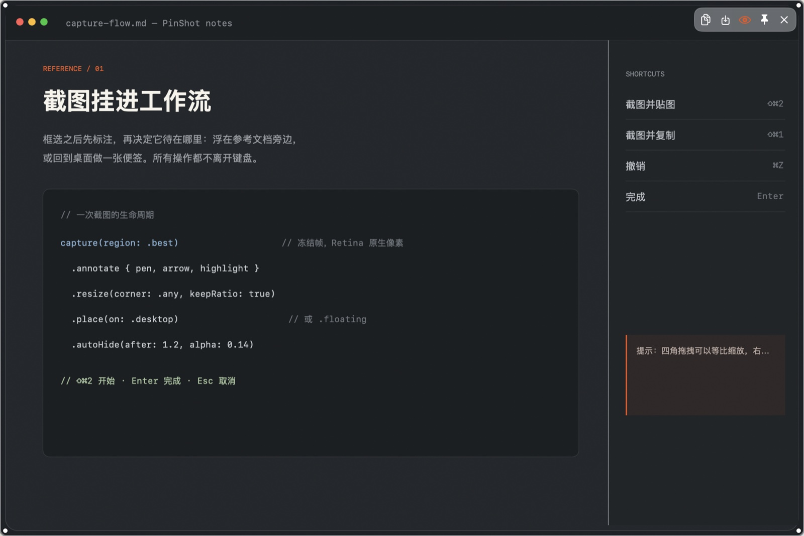 | 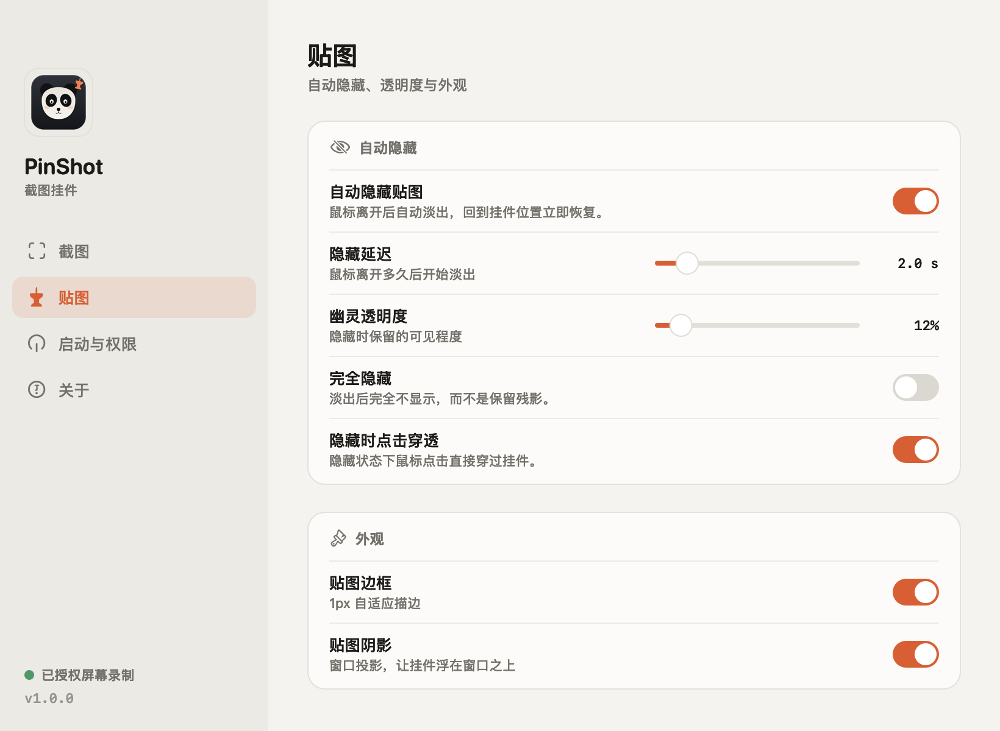 |

| 标注编辑器 | 首次引导 |
| --- | --- |
| 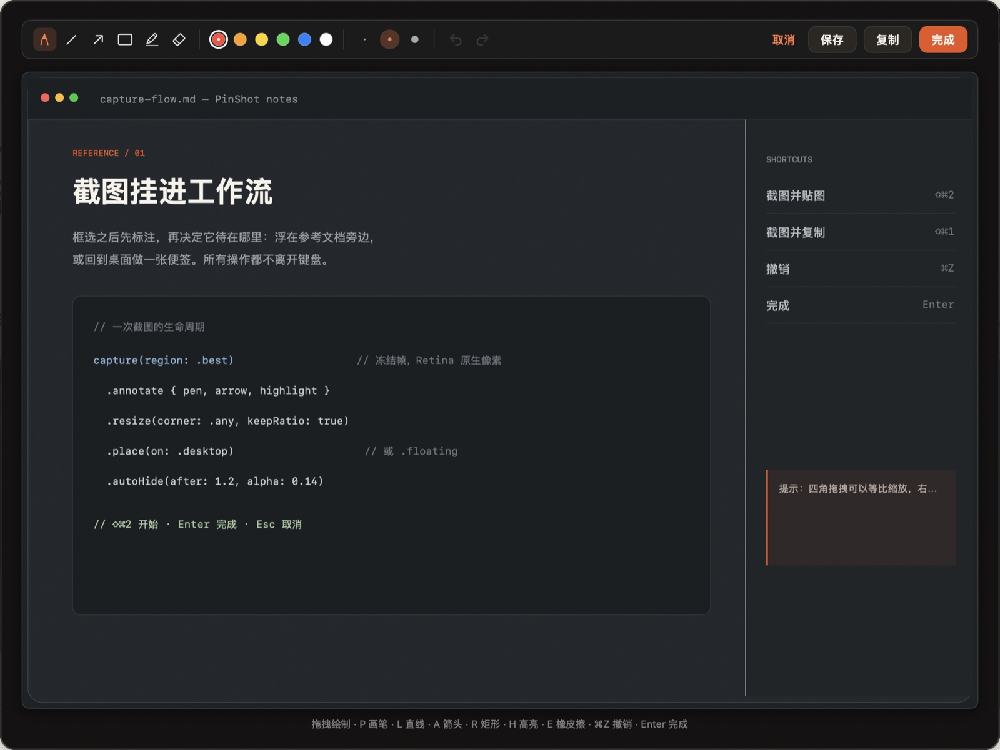 | 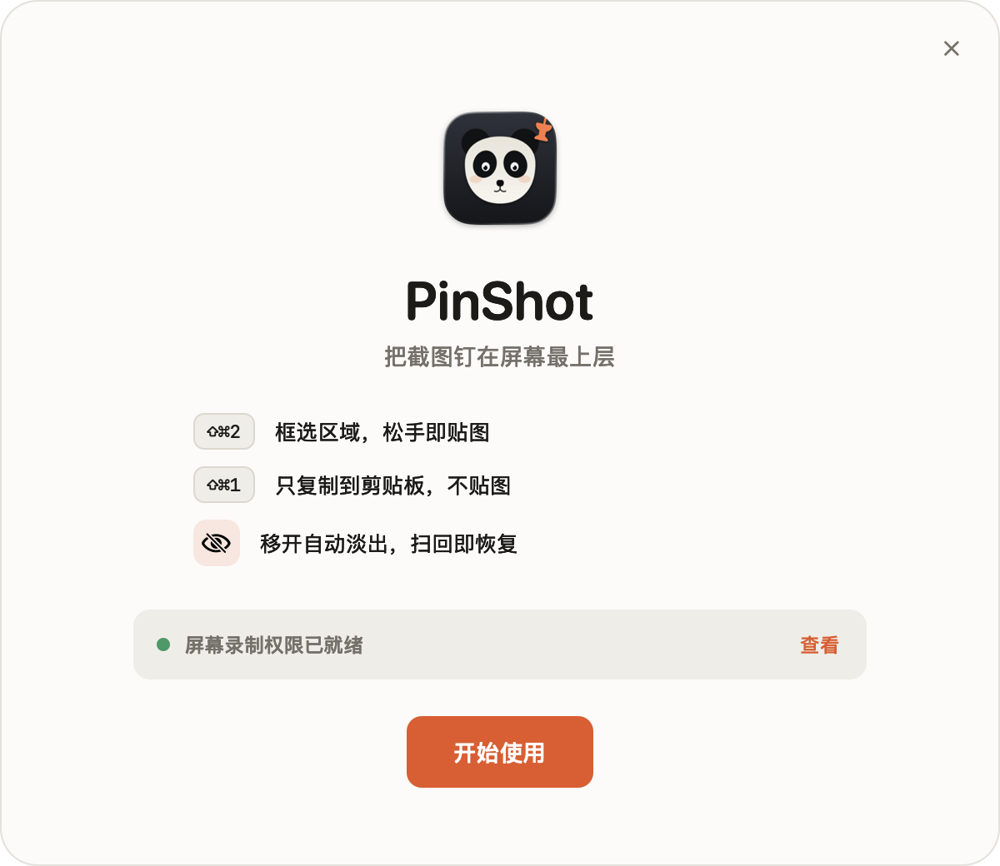 |

| 权限引导 | 菜单栏 |
| --- | --- |
| 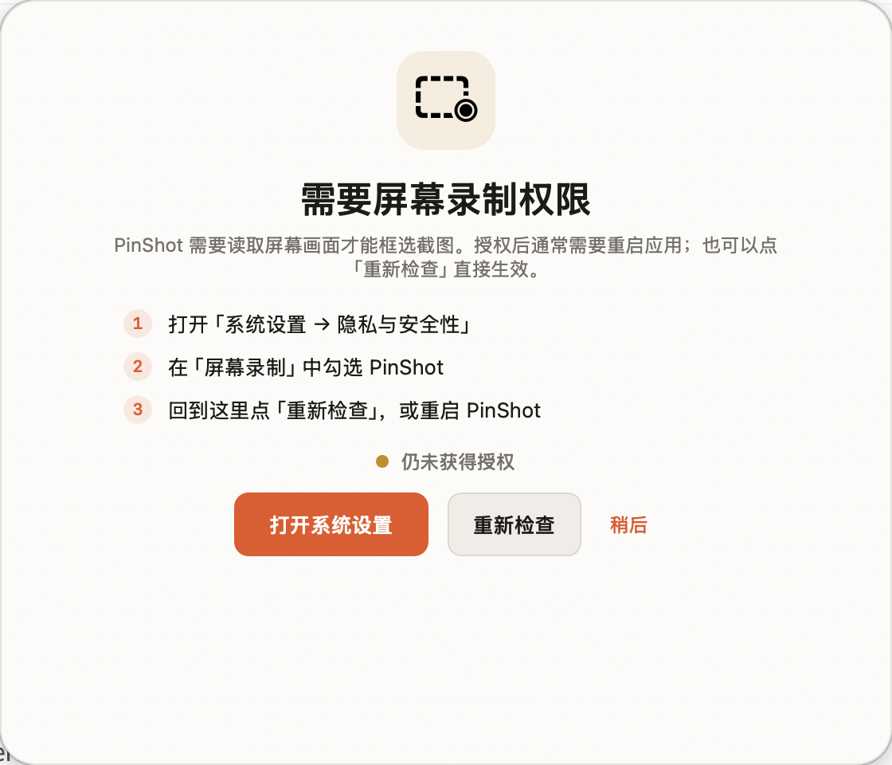 | 菜单栏提供截图、隐藏全部、放置模式、设置与权限入口 |


## 功能

- **框选截图即贴图**：冻结帧框选（截图里不会出现遮罩），Shift 约束正方形，Retina 原生像素，多显示器支持。
- **Shottr 风格截图模式**：窗口截图（当前前台窗口）、全屏截图、3/5/10 秒延时截图、重复上次框选区域（菜单栏入口）。
- **截图后标注**：框选完成进入标注编辑器，支持画笔 / 直线 / 箭头 / 矩形 / 高亮 / 橡皮擦，撤销重做、颜色与粗细；完成直接贴图，也可复制或保存 PNG。
- **剪贴板贴图兜底**：菜单栏「从剪贴板贴图…」可直接把系统截图（`⇧⌃⌘4` 复制到剪贴板）做成可标注的贴图；在屏幕录制授权异常时仍可使用全部标注 / 贴图能力。
- **置顶挂件**：无边框浮窗，出现在选区原位；拖拽移动、四角等比缩放（也可右键选 100/75/50/25% 或适合屏幕）、圆角 + 阴影 + 描边。
- **挂在桌面**：每个贴图可在「浮于最上层」与「挂在桌面（窗口下层，像桌面便签）」之间切换；设置里可设新贴图默认放置方式。挂在桌面时自动隐藏暂停，移开窗口/显示桌面即可看到。
- **自动隐藏**：鼠标离开 N 秒后淡出到幽灵透明度并**点击穿透**，鼠标扫回原位置立即恢复；可暂停、可完全隐藏。
- **悬停工具栏**：复制 / 保存 / 自动隐藏开关 / 桌面模式 / 关闭；右键菜单更完整（存桌面、不透明度、缩放、关闭全部）。
- **快捷键**：截图并贴图 `⇧⌘2`、截图并复制 `⇧⌘1`，可在设置中重新录制。
- **开机启动 / 设置持久化 / 权限引导**：全部在菜单栏里完成。

## 标注编辑器

框选完成后自动进入标注编辑器：画笔 / 直线 / 箭头 / 矩形 / 高亮 / 橡皮擦，6 色板、3 档粗细、撤销重做；`Enter` 直接完成贴图，也可复制或保存 PNG。标注结果以原生像素合成，Retina 下依然清晰。

- 快捷键：`P` 画笔、`L` 直线、`A` 箭头、`R` 矩形、`H` 高亮、`E` 橡皮擦；`⌘Z` / `⇧⌘Z` 撤销重做；`⌘C` 复制、`⌘S` 保存、`Enter` 完成、`Esc` 取消。
- 设计说明：[docs/ANNOTATION-DESIGN.md](docs/ANNOTATION-DESIGN.md)

## 界面设计

PinShot 有一套自己的视觉语言（**Capture instrument**）：暖石墨中性色 + 信号橙，大圆角卡片，自绘开关 / 滑杆 / 按钮，快捷键做成实体键帽，选区用橙色裁切角标。

**熊猫主题 App 图标**：石墨底 + 熊猫脸 + 橙色图钉，出现在 Finder / 设置侧边栏 / 首次引导 / 关于页；图标由 `scripts/make-icon.swift` 用 AppKit 矢量绘制生成。


- 设计说明：[docs/UI-REDESIGN.md](docs/UI-REDESIGN.md)
- 设计系统代码：`Sources/UI/Theme.swift`（颜色 / 字体 / 尺寸 / 卡片）与 `Sources/UI/Controls.swift`（开关 / 滑杆 / 按钮 / 键帽）
- 浅色 / 深色自动适配；设置窗口 820×600 侧边栏布局，首次引导与权限引导为自绘卡片窗口。

| 截图页 | 贴图页（浅色） | 深色 |
| --- | --- | --- |
| 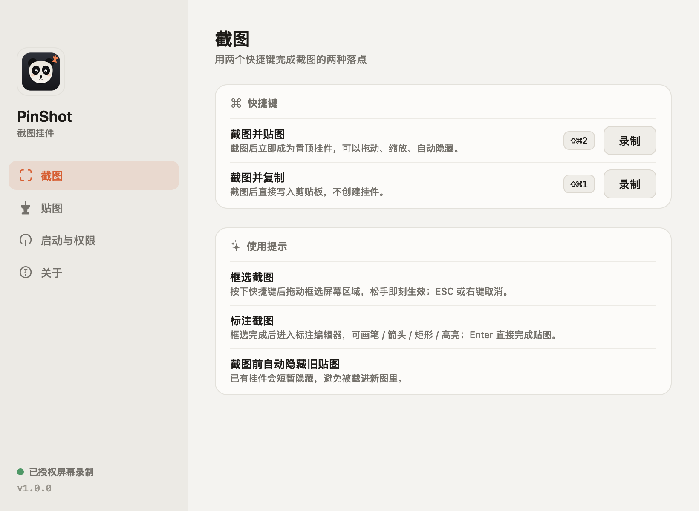 | 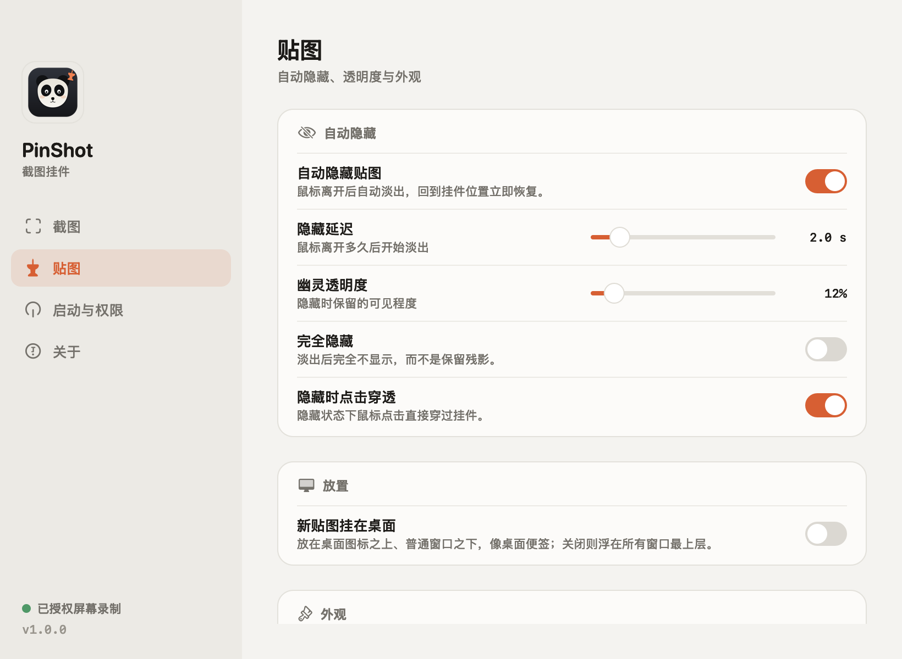 | 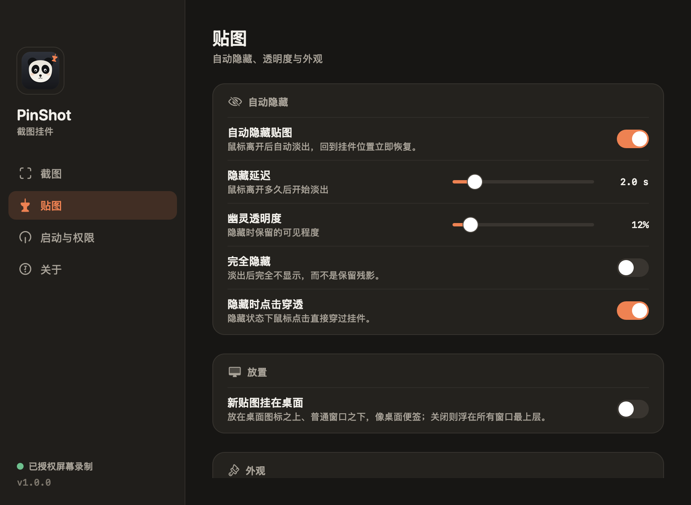 |

## 安装

直接下载（macOS 14+ / Apple Silicon）：
[DMG](https://github.com/xincxiong/PinShot/releases/download/v1.0.0/PinShot-1.0.0-macOS-arm64.dmg) ·
[ZIP](https://github.com/xincxiong/PinShot/releases/download/v1.0.0/PinShot-1.0.0-macOS-arm64.zip) ·
[版本说明](https://github.com/xincxiong/PinShot/releases/tag/v1.0.0)

Windows 10/11 x64（Beta）：
[ZIP](https://github.com/xincxiong/PinShot/releases/download/v1.0.0-windows/PinShot-1.0.0-windows-x64.zip) ·
[Windows 说明](windows/README.md)

### Windows 版

`windows/` 是用 Electron 实现的 Windows MVP，包含托盘、区域截图、标注、贴图、自动隐藏与设置；运行与交叉打包见 [`windows/README.md`](windows/README.md)。Windows 版为 Beta：未签名、桌面模式为近似实现，暂不含安装器与自启。

### 从源码构建（本机没有 Xcode 也可以）

要求：macOS 14+、Command Line Tools（`xcode-select --install`）。

```bash
cd PinShot
make build        # 产出 build/PinShot.app
make run          # 启动（菜单栏出现 📌）
make install      # 安装到 ~/Applications（之后 open ~/Applications/PinShot.app 启动）
```

构建脚本用 `swiftc` + Makefile 直接组装 `.app` 并 ad-hoc 签名，不需要 SwiftPM / Xcode 工程。

### 首次使用

1. 启动后菜单栏出现 📌；
2. 按 `⇧⌘2`，系统会弹出「屏幕录制」授权 —— 前往「系统设置 → 隐私与安全性 → 屏幕录制」勾选 PinShot；
3. **退出并重新打开 PinShot**，再次按 `⇧⌘2` 即可截图。

> 首次运行会有一个简短的使用引导。

## 使用

| 操作 | 行为 |
| --- | --- |
| `⇧⌘2` | 框选截图 → 标注编辑器 → 完成贴图 |
| `⇧⌘1` | 框选截图 → 标注编辑器 → 复制到剪贴板（不贴图） |
| 拖拽挂件 | 移动位置 |
| 拖拽四角把手 | 等比缩放（悬停时出现白色圆点） |
| 右键 → 缩放 | 100% / 75% / 50% / 25% / 适合屏幕 |
| 工具栏桌面按钮 | 在「浮于最上层」与「挂在桌面」之间切换 |
| 设置 → 贴图 → 放置 | 新贴图默认挂在桌面 |
| 悬停挂件 | 出现工具栏 |
| 右键挂件 | 复制 / 存储为 / 存桌面 / 自动隐藏 / 不透明度 / 关闭全部 |
| `⌘C` / `⌘S` / `⌘W` / `Esc` | 复制 / 另存为 / 关闭当前挂件 |
| 方向键 | 1pt 微调（`⇧` + 方向键 10pt） |
| 标注编辑器 | 画笔/直线/箭头/矩形/高亮/橡皮擦，`⌘Z` 撤销、`Enter` 完成、`Esc` 取消 |
| `Shift` 拖拽框选 | 约束为正方形选区 |
| 菜单栏「窗口截图 / 全屏截图」 | 当前前台窗口 / 鼠标所在显示器整屏 |
| 菜单栏「延时截图」 | 3 / 5 / 10 秒后开始框选 |
| 菜单栏「重复上次区域」 | 复现上一次框选位置 |
| 四角拖拽 | 等比缩放，拖拽时显示尺寸徽标 |
| `⌘T` / 底部「识别文字」 | 离线 OCR，识别结果可直接复制（贴图工具栏也有） |
| `Shift` 拖拽框选 | 约束为正方形选区 |
| 菜单栏「窗口截图 / 全屏截图」 | 当前前台窗口 / 鼠标所在显示器整屏 |
| 菜单栏「延时截图」 | 3 / 5 / 10 秒后开始框选 |
| 菜单栏「重复上次区域」 | 复现上一次框选位置 |
| 四角拖拽 | 等比缩放，拖拽时显示尺寸徽标 |
| `⌘T` / 底部「识别文字」 | 离线 OCR，识别结果可直接复制（贴图工具栏也有） |
| 贴图工具栏 🖥 | 切换「浮于最上层 / 挂在桌面」 |
| 从剪贴板贴图 | 用 `⇧⌃⌘4`/`⇧⌃⌘3` 系统截图复制到剪贴板，再从菜单选择「从剪贴板贴图…」 |
| 菜单栏 📌 | 截图、隐藏全部、自动隐藏开关、设置、权限、使用引导、退出 |

自动隐藏的默认参数：鼠标离开 **2 秒** 后淡出到 **12%** 透明度并点击穿透；鼠标扫回原位 **0.18 秒** 内恢复。可在设置里调延迟、透明度，或切换「完全隐藏」「暂停自动隐藏」。

## 设置

菜单栏 →「设置…」（`⌘,`）。设置窗口采用侧边栏导航，分四页：

- **截图**：两个快捷键行内录制（键帽实时预览，ESC 取消，冲突用行内红字提示）
- **贴图**：自动隐藏开关 / 延迟滑杆 / 幽灵透明度滑杆 / 完全隐藏 / 隐藏时点击穿透；外观（边框、阴影）
- **启动与权限**：登录时自动启动、屏幕录制权限状态与一键跳转 / 重新检查、恢复默认设置
- **关于**：版本、快捷键、设计与实现说明

所有开关、滑杆、按钮都是自绘控件，深浅色一致；窗口只保留关闭按钮，可拖动空白处移动。

## 权限说明

截图必须获得 macOS 的「屏幕录制」权限（TCC），这是系统强制要求，与签名方式无关。

- 授权后**必须重启 PinShot** 才会生效；若出现黑屏/旧画面，先退出重开。
- 本机无开发者证书，构建使用 ad-hoc 签名。**重新 `make build` 后签名会变化，系统可能要求重新授权**：到「系统设置 → 隐私与安全性 → 屏幕录制」删除旧的 PinShot 条目（− 号），再重新添加 / 重新勾选。
- 固定安装路径（推荐 `make install` 到 `~/Applications/PinShot.app`）可以减少 TCC 重复授权。
- 本版本改为**跨构建稳定的签名 requirement**（`designated => identifier "com.kuxin.pinshot"`），正常情况下重新 `make build` 不会再让屏幕录制授权失效；若仍遇到失效，按上面的「删除旧条目 → 重新添加当前 App」处理一次。
- 修改「屏幕录制」列表时 macOS 会要求 Touch ID 或密码验证，请先通过验证。
- 如果遇到「开关已打开但仍提示未授权」的陈旧 TCC 条目，运行一次：
  ```bash
  ./scripts/reset-screen-permission.sh
  ```
  它会重置本 App 的屏幕录制授权并重新打开应用；之后按 ⇧⌘2 重新授权即可。
- **每次重新 `make build` 后 ad-hoc 签名都会变化，大概率需要重新授权一次**（UI 改版后的本次构建就是这样）；这是开发期签名机制，不是应用 bug。
- **如果系统设置里 PinShot 开关已经打开，但 PinShot 仍提示未授权**：说明旧的授权条目和当前构建不匹配。到「屏幕录制」列表里选中 PinShot 点「−」删除，再点「+」选择 `PinShot/build/PinShot.app`（或把 App 拖进列表）重新勾选，然后重启 PinShot。新版权限引导内置了「重新检查」和「授权无效？查看重新授权步骤」，可以按提示操作。

## 开发

```bash
make typecheck     # 全量类型检查
make fast          # 快速构建（-Onone）
make build         # 优化构建
make test          # 单元测试（坐标换算 / 裁剪 / 快捷键）
make render-test   # 离屏渲染自检：build/render/*.png（无需屏幕录制权限）
make clean
```

- 架构与设计：[docs/DESIGN.md](docs/DESIGN.md)
- 界面设计说明：[docs/UI-REDESIGN.md](docs/UI-REDESIGN.md)
- 标注编辑器设计：[docs/ANNOTATION-DESIGN.md](docs/ANNOTATION-DESIGN.md)
- 构建产物：`build/PinShot.app`；编译缓存放在 `build/` 内，避免污染系统目录。
- 单元测试与「离屏渲染自检」不需要屏幕录制权限，CI/沙箱里也能跑。

### 目录

```
Sources/
├── App/       启动入口、状态栏菜单、截图流程编排、调试启动参数
├── Core/      截图、坐标换算、设置、全局热键、贴图管理、开机启动
├── UI/        设计系统（Theme/Controls）、选区覆盖层、置顶挂件与工具栏、
│              自动隐藏、设置窗口、首次引导 / 权限引导
└── Support/   离屏渲染自检（--render-test / --render-ui）
Tests/         纯逻辑单元测试
Resources/     Info.plist、AppIcon.icns
scripts/       构建 / 类型检查 / 测试 / 图标生成
docs/          设计文档、验收报告、界面图
```

### 调试启动参数（不影响正常使用）

```bash
build/PinShot.app/Contents/MacOS/PinShot --render-test build/render   # 离屏渲染自检
build/PinShot.app/Contents/MacOS/PinShot --demo-pin --quit-after 15    # 抓屏并创建演示贴图
build/PinShot.app/Contents/MacOS/PinShot --demo-overlay --quit-after 8 # 展示选区覆盖层
build/PinShot.app/Contents/MacOS/PinShot --settings                    # 启动后打开设置
build/PinShot.app/Contents/MacOS/PinShot --render-ui build/ui          # 离屏渲染 4 个设置页 + 引导窗（浅/深色）
build/PinShot.app/Contents/MacOS/PinShot --settings --dark             # 强制深色外观打开设置
build/PinShot.app/Contents/MacOS/PinShot --open-menu                   # 启动后展开菜单栏菜单（截图用）
```

- 验收结果与待人工清单：[docs/ACCEPTANCE.md](docs/ACCEPTANCE.md)

## 已知限制

- 一次拖拽只能在一个屏幕内框选（跨屏选择暂不支持）。
- 贴图不跨启动持久化（退出应用即关闭）。
- 挂件宽度小于约 130pt 时放不下悬浮工具栏（改用右键菜单 / 键盘）。
- 滚轮落在挂件上不会转发给下层应用。
- 挂在桌面的贴图位于普通窗口下方，需要先显示桌面或移开窗口才能看到；桌面模式下自动隐藏暂时关闭。
- 窗口/控件级截图、滚动截图、OCR 暂未实现（设计文档中有后续规划）。
- 标注编辑器暂不支持文字、马赛克、序号等工具；如需可后续扩展。

## 贡献

欢迎 Issue / PR。开发、构建和测试说明见 [CONTRIBUTING.md](CONTRIBUTING.md)。

## License

[MIT](LICENSE) © 2026 PinShot contributors
